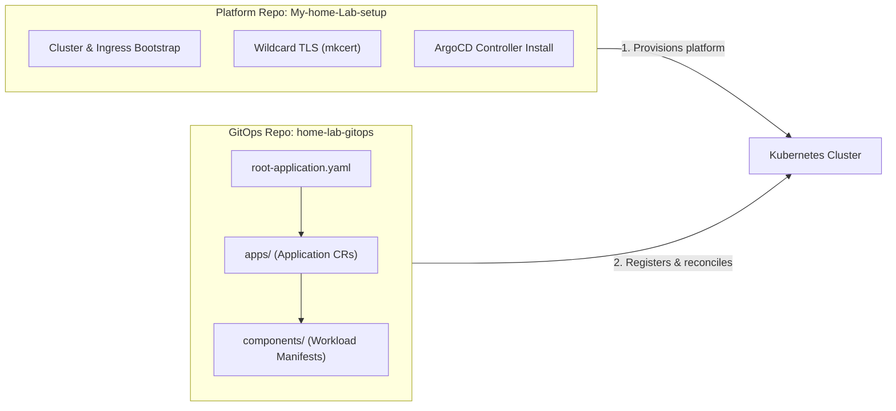
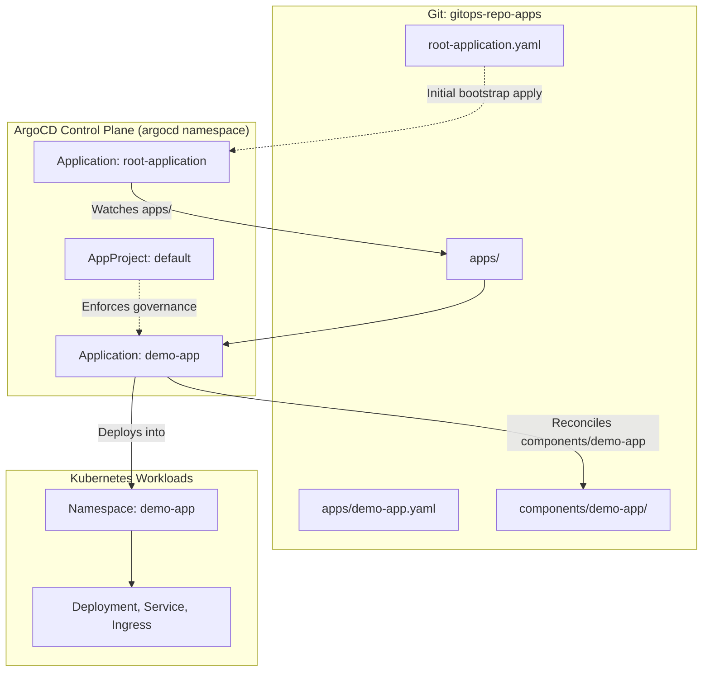

# GitOps Architecture Guide

A comprehensive architectural reference for declarative cluster delivery using **ArgoCD** and the **App of Apps** pattern.

---

## 1. Overview & Core Principles

In traditional Kubernetes operations, teams apply workloads imperatively using CLI commands (`kubectl apply`, `helm install`). While functional for experiments, imperative operations quickly lead to **cluster drift**, undocumented manual hotfixes, and broken recovery paths.

**GitOps** replaces imperative workflows with three core principles:
1. **Declarative State**: The desired state of the entire system (infrastructure, configuration, workloads) is version-controlled in Git.
2. **Automated Reconciliation**: An in-cluster controller (ArgoCD) continuously monitors Git and compares it to live cluster resources.
3. **Self-Healing & Drift Correction**: Any manual changes applied directly to the cluster with `kubectl` are automatically detected and reverted to match Git.

---

## 2. Architecture: The Two-Repository Pattern

This laboratory strictly separates the **cluster lifecycle** from the **application delivery lifecycle**:



* **Platform Repository (`My-home-Lab-setup`)**: Provisions Kubernetes, verifies Ingress-NGINX, injects trusted local wildcard TLS certificates, and installs the ArgoCD operator. Its responsibility ends once the platform is healthy.
* **GitOps Repository (`home-lab-gitops`)**: The single source of truth for all applications, databases, and microservices. The platform registers this repository by applying `root-application.yaml`.

---

## 3. The Three Pillars of ArgoCD



---

### Pillar 1: The Root Application (App of Apps)

Deploying individual `Application` manifests manually would reintroduce imperative friction. The **App of Apps pattern** solves this chicken-and-egg problem by using one parent Application whose sole job is to watch the `apps/` directory and dynamically instantiate child Application resources.

#### Root Application Manifest (`root-application.yaml`)

```yaml
apiVersion: argoproj.io/v1alpha1
kind: Application
metadata:
  name: root-application
  namespace: argocd
  finalizers:
    - resources-finalizer.argocd.argoproj.io
spec:
  project: default
  source:
    repoURL: https://github.com/vmalani27/gitops-repo-apps.git
    targetRevision: main
    path: apps
  destination:
    server: https://kubernetes.default.svc
    namespace: argocd
  syncPolicy:
    automated:
      prune: true
      selfHeal: true
    syncOptions:
      - CreateNamespace=true
```

#### Why App of Apps?
* **Independent Failure Domains**: A syntax error in one component only causes that specific child application to turn `OutOfSync`. The remaining services continue running and synchronizing normally.
* **Granular UI & Operations**: Each microservice gets its own dedicated card in the ArgoCD web console, with dedicated sync history, diff views, and rollback triggers.

---

### Pillar 2: ArgoCD Projects (`AppProject`)

An `AppProject` provides a logical governance boundary and tenancy sandbox. While local labs use the `default` project, enterprise clusters configure dedicated AppProjects to restrict blast radius:

| Capability | What It Controls |
|---|---|
| **`sourceRepos`** | Whitelists allowed Git repository URLs and branches. |
| **`destinations`** | Restricts which clusters and namespaces applications can deploy to. |
| **`clusterResourceWhitelist`** | Prevents applications from creating privileged cluster-level resources (e.g., `ClusterRole`, `CustomResourceDefinition`). |
| **`namespaceResourceWhitelist`** | Restricts allowable namespace-scoped resources (e.g., permits `Deployment`, `Service`, `Ingress`, but forbids raw `Secret` manipulation). |
| **RBAC & Roles** | Grants read-only or sync permissions to specific user groups and CI/CD tokens. |

---

### Pillar 3: Child Applications (`Application` CR)

Each component in `components/` has a corresponding manifest in `apps/`. This manifest binds a Git path to a destination namespace with specific reconciliation policies.

#### Child Application Manifest (`apps/demo-app.yaml`)

```yaml
apiVersion: argoproj.io/v1alpha1
kind: Application
metadata:
  name: demo-app
  namespace: argocd
  finalizers:
    - resources-finalizer.argocd.argoproj.io
spec:
  project: default
  source:
    repoURL: https://github.com/vmalani27/gitops-repo-apps.git
    targetRevision: main
    path: components/demo-app
  destination:
    server: https://kubernetes.default.svc
    namespace: demo-app
  syncPolicy:
    automated:
      prune: true
      selfHeal: true
    syncOptions:
      - CreateNamespace=true
```

#### Key Synchronization Policies
* **`automated.prune: true`**: When you delete a Kubernetes manifest from Git, ArgoCD automatically garbage-collects and deletes the corresponding resource from the cluster.
* **`automated.selfHeal: true`**: If a developer or script modifies a cluster resource using `kubectl edit` or deletes a pod, ArgoCD detects the discrepancy and overwrites the cluster to match the version in Git.
* **`CreateNamespace=true`**: Automatically creates the destination namespace if it does not yet exist.

---

## 4. Hands-on GitOps Experiments

Verify these concepts in real-time on your running cluster:

### Experiment 1: Test Self-Healing (Break and Auto-Recover)

Imperatively delete the running demo app pod:
```bash
kubectl delete pod -n demo-app -l app=demo-app
```
**Observation**: ArgoCD detects the missing resource and immediately reconciles the ReplicaSet, bringing up a replacement pod within seconds to match the Git state.

---

### Experiment 2: Inspect Application Hierarchy via CLI

Check status across all registered applications:
```bash
kubectl get applications -n argocd -o wide
```

Inspect detailed live synchronization diffs:
```bash
kubectl describe application demo-app -n argocd
```

---

### Experiment 3: Declarative GitOps Rollout

1. Open `components/demo-app/manifests.yaml`.
2. Change `replicas: 1` to `replicas: 3`.
3. Commit and push:
   ```bash
   git commit -am "chore(demo-app): scale to 3 replicas"
   git push origin main
   ```
4. Observe ArgoCD automatically detecting the new commit and scaling the Deployment to 3 pods without any manual `kubectl` intervention.
